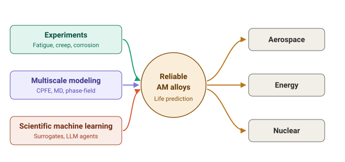
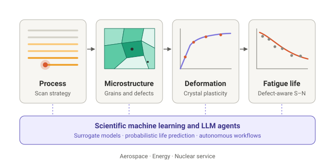

I study how additively manufactured alloys fail, and how to predict it, by combining experiments, multiscale modeling, and artificial intelligence.

<figure class="research-figure">
  <picture>
  <source media="(max-width: 600px)" srcset="/assets/images/research-overview-mobile.svg">
  
  </picture>
</figure>

My research areas include:

<strong>Experiments</strong>

* Mechanics of materials (fatigue, fracture, creep, corrosion)
* Environment-assisted cracking
* Additive manufacturing (High performance alloys)

<strong>Multiscale modeling</strong>

* Multiscale modeling (Molecular dynamics, crystal plasticity, phase-field)

<strong>Scientific machine learning</strong>

* Scientific machine learning
* Materials informatics

<strong>Earlier work</strong>

* Virtual surgery

### From process to performance

<figure class="research-figure">
  <picture>
  <source media="(max-width: 600px)" srcset="/assets/images/research-multiscale-mobile.svg">
  
  </picture>
  <figcaption>The scan strategy shapes the microstructure, the microstructure governs deformation, and deformation sets fatigue life. Scientific machine learning and LLM agents connect every stage.</figcaption>
</figure>

